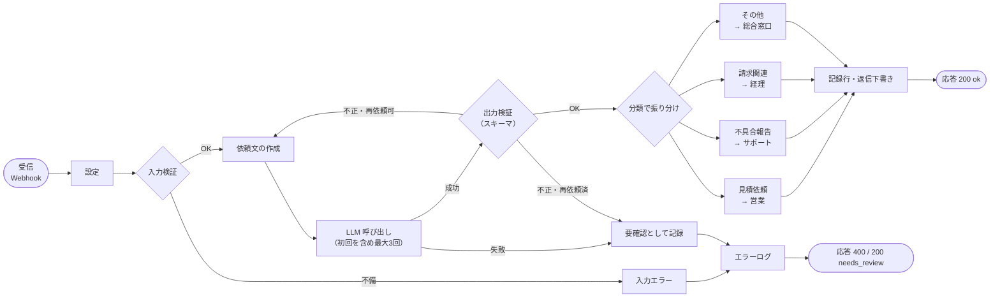

# n8n AI問い合わせメール仕分け

[](https://github.com/takato-y/n8n-ai-mail-triage/actions/workflows/static-check.yml)

- GitHub Actions で検査している範囲：ワークフロー JSON の再生成との一致、設計書のエラーIDと障害対応手順書の突き合わせ（n8n 本体は使わない静的検査）
- 手元の環境でのみ確認した範囲：n8n と LLM を使う動作テスト（tests/run_live.py、TC-001〜008）

本リポジトリはポートフォリオ（閲覧用）です。無断での再利用・再配布はご遠慮ください。

## 概要

問い合わせメールの仕分けと一次対応を自動にする仕組みです。生成AI（文章を読んで分類や要約ができる AI）がメールを読み、n8n（さまざまなサービスをつないで業務を自動化するツール）の上で、分類から返信の下書きまでを進めます。

| これまで | 導入後 |
|---|---|
| 担当者が1通ずつ読み、どの窓口の案件かを判断して振り分ける | 自動で分類し、担当窓口（営業・サポート・経理・総合窓口）に振り分ける |
| 会社名・用件・急ぎかどうかを読み取り、台帳に書き写す | 会社名・担当者名・用件の要約・緊急度を自動で取り出し、記録用の行を作る |
| 一次返信を毎回書く | 分類に合った返信の下書きを自動で作る（送信は人が確認してから） |
| 急ぎの問い合わせが他のメールに埋もれ、見落とすことがある | 緊急度を「高／中／低」で付け、急ぎのものを見分けやすくする |
| 確認が漏れた問い合わせに気付きにくい | AI が判断できなかったものは「要確認」として残し、取りこぼさない |

作成者は n8n 公式の Verified Creator（認定テンプレート作成者）です。本リポジトリは、設計の考え方を示すための小さな構成の事例です。

## できること

- 問い合わせを **見積依頼／不具合報告／請求関連／その他** の4つに分類
- **会社名・担当者名・用件の要約・緊急度（高／中／低）** を取り出し
- 分類ごとに **担当窓口** を決め、**記録用の行データ** と **返信の下書き** を作成
- AI が失敗した問い合わせは **「要確認」** として記録し、人の確認に回す
- 失敗の内容を **エラーログ**（段階・理由・時刻。本文は含めない）として残す
- 使う AI をローカルとクラウドで切り替えられる設計（動作確認はローカルの Ollama のみ）

## ワークフロー図



ノード単位の図と一覧は [フロー設計書](docs/03_フロー設計.md) にあります。

## 実行例（入力→出力）

ローカルの n8n と Ollama（qwen2.5:7b）で実際に実行した結果です。サンプルのメールはすべて架空のものです。

**入力**（Webhook に POST）

```json
{
  "from": "suzuki@example.jp",
  "subject": "【至急】ログインできない不具合",
  "body": "架空商事の鈴木です。\n本日9時ごろから、納品いただいた受注システムにログインすると「500エラー」が表示され、全員が操作できない状態です。\n本日中の出荷処理が止まっていますので、至急ご確認をお願いします。\n\n架空商事株式会社 物流課 鈴木 一郎"
}
```

**出力**（HTTP 200・一部省略）

```json
{
  "status": "ok",
  "category": "不具合報告",
  "extracted": {
    "category": "不具合報告",
    "company": "架空商事株式会社",
    "contact_name": "鈴木 一郎",
    "summary": "受注システムにログインできず、500エラーが表示され出荷処理が止まっている。",
    "urgency": "高"
  },
  "route": "サポート",
  "record": { "category": "不具合報告", "route": "サポート", "urgency": "高", "status": "未対応", "...": "..." },
  "replyDraft": "架空商事株式会社\n鈴木 一郎 様\n\nご不便をおかけしており、申し訳ございません。\n調査のため、発生日時・操作の手順・表示された画面の内容をお知らせいただけますでしょうか。\n...",
  "attempts": 1
}
```

**全テストケースの結果**（TC-001〜008 は 2026-11-15、TC-009 は 2026-11-16 実施・9件中9件合格）

| ID | 入力 | 結果 |
|---|---|---|
| TC-001 | 見積の依頼 | 見積依頼／営業 |
| TC-002 | ログインできない不具合（至急） | 不具合報告／サポート／緊急度 高 |
| TC-003 | 請求書の金額の確認 | 請求関連／経理 |
| TC-004 | 取材の依頼 | その他／総合窓口 |
| TC-005 | 件名・本文が空 | HTTP 400 入力エラー（LLM は呼ばない） |
| TC-006 | LLM が 503 を返し続ける | 3回呼び出した後、要確認として記録 |
| TC-007 | LLM が JSON でない文章を返す | 1回再依頼した後、要確認として記録 |
| TC-008 | LLM に接続できない | 要確認として記録 |
| TC-009 | 設計書のエラーIDと障害対応手順書の突き合わせ（n8n 不要） | 4件すべて対応手順あり |

詳細は [テスト仕様書](docs/04_テスト仕様書.md) にあります。

## 導入方法

1. **JSON のインポート**：n8n で新規ワークフローを開き、[workflow/ai-mail-triage.json](workflow/ai-mail-triage.json) を読み込みます
2. **LLM の設定**：`Set Config` ノードの `llm_base_url` と `llm_model` を使う LLM に合わせます（既定はローカルの Ollama）
3. **資格情報の設定**：クラウドの LLM を使う場合は、`Call LLM` ノードに Header Auth（API キーをヘッダーに付けて送る認証方式）の資格情報を設定します。API キーはワークフローに直接書かず、n8n の資格情報にだけ保存します。配布している JSON には資格情報を含めていません
4. **トリガーの差し替え**：メールで受ける場合は、`Receive Inquiry`（Webhook）を Gmail または IMAP のトリガーに差し替え、差出人・件名・本文を `from`・`subject`・`body` に詰め替えるノードを1つ置きます（差し替え後の動作は未検証）

Webhook は認証なしの構成です。外部に公開する場合は Header Auth などの資格情報を設定してください（[フロー設計書](docs/03_フロー設計.md) の資格情報一覧を参照）。

手順の詳細は [導入・運用手順書](docs/05_導入・運用手順.md) にあります。

## 工夫した点

### 構造化出力の検証

取り出した項目は、後続の処理で扱いやすい JSON（決まった形のデータ）で受け取ります。LLM に JSON で答えるよう指示しても、説明文が付く・項目が欠ける・選択肢にない値が返る、といった崩れは起こります。そこで、回答を Code ノードで JSON として読み、**必須項目・型・選択肢・文字数** をスキーマ（項目と値の決まりを定めたもの）に沿って検証してから後続に渡しています。スキーマにない項目は取り除くため、振り分けの条件は検証済みの値だけを見れば済みます。（[ADR-0002](docs/adr/0002-structured-output-validation.md)）

### 失敗時の分岐

入力の不備、LLM の通信失敗、出力の不正を **1つのエラー経路** に集め、どの場合も呼び出し元に結果を返します。AI が分類できなかった問い合わせは「要確認」として記録し、取りこぼしません。エラーログには段階・理由・試行回数を残し、問い合わせの本文や差出人は含めません。

### 再試行

失敗の種類によって再試行の方法を分けています。

| 失敗の種類 | 再試行 |
|---|---|
| 通信の失敗（接続できない・5xx） | 同じ依頼を初回を含めて最大3回まで送る（間隔2秒） |
| 出力の形式不正 | 不正の理由を添えて1回だけ再依頼 |
| 入力の不備 | 再試行しない（LLM を呼ばない） |

1通あたりの LLM の呼び出し回数に上限があるため、障害時に費用や待ち時間が膨らみません。再試行と再依頼の回数は、テスト用の偽 LLM サーバーで実際に数えて確認しています。

### 実行データの保存

n8n は既定で実行ごとの入出力（メール本文を含む）を保存します。本ワークフローでは、成功した実行のデータを保存しない設定にしています（`saveDataSuccessExecution: none`）。詳しくは [導入・運用手順書](docs/05_導入・運用手順.md) の「実行データの保存」を参照してください。

### LLM の差し替え

LLM は OpenAI 互換の API を HTTP Request ノードで呼び出します。開発やテストはローカルの LLM（費用なし・外部送信なし）、本番はクラウドの LLM、といった切り替えを接続先とモデル名の変更で行える設計です（動作確認はローカルの Ollama のみ。クラウド LLM での動作は未実施）。（[ADR-0003](docs/adr/0003-openai-compatible-llm-provider.md)）

## 設計書

| 文書 | 内容 |
|---|---|
| [01 要件定義](docs/01_要件定義.md) | 背景・目的、機能要件（REQ）、非機能要件、対象外 |
| [02 基本設計](docs/02_基本設計.md) | 全体構成、機能一覧（FN）、分類の定義、抽出項目の JSON スキーマ |
| [03 フロー設計](docs/03_フロー設計.md) | ノード一覧、分岐条件、エラー処理表（ERR）、資格情報一覧 |
| [04 テスト仕様書](docs/04_テスト仕様書.md) | テストケース（TC）と実施結果 |
| [05 導入・運用手順](docs/05_導入・運用手順.md) | インポート、資格情報、トリガーの差し替え、監視・定期点検、バックアップと戻し方、資格情報の更新、連絡体制 |
| [06 障害対応手順書](docs/06_障害対応手順書.md) | 障害時の流れ、切り分けの順番、エラーID（ERR-001〜004）ごとの対応手順、記録と報告 |
| [ADR](docs/adr/) | 主要な設計判断の記録（3件） |
| [CHANGELOG](CHANGELOG.md) | 変更履歴 |

### 要件からテストまでの対応

| 要件 | 機能 | テストケース |
|---|---|---|
| REQ-001 受付 | FN-001 | TC-001〜005 |
| REQ-002 分類 | FN-002 | TC-001〜004 |
| REQ-003 抽出 | FN-002 | TC-001〜004 |
| REQ-004 振り分け・下書き | FN-004 | TC-001〜004 |
| REQ-005 入力不備 | FN-001 | TC-005 |
| REQ-006 通信失敗の再試行 | FN-002、FN-005 | TC-006、TC-008 |
| REQ-007 出力検証・再依頼 | FN-003 | TC-007 |
| REQ-008 エラーログ | FN-005 | TC-005〜008 |
| REQ-009 LLM の差し替え | FN-002 | 一部確認（接続先の変更は TC-006〜008 で確認。クラウド LLM は未実施） |
| REQ-010 トリガーの差し替え | FN-001 | 未実施（手順のみ） |

## 動作環境

| 項目 | 内容 |
|---|---|
| n8n | 2.3.5（セルフホスト・Docker）で動作確認 |
| LLM | Ollama・qwen2.5:7b で動作確認。OpenAI 互換の Chat Completions API を持つ LLM（クラウドサービス等）に対応する設計（クラウド LLM での動作は未実施） |
| 実行データ | 成功した実行の入出力は保存しない設定（失敗した実行は調査のため保存。保存期間は n8n 側で設定） |
| テスト | Python 3（標準ライブラリのみ）。`tests/run_live.py` がローカルの n8n にテスト用の写しを作り、実行後に削除します。設計書と障害対応手順書の突き合わせは `python3 tools/check_docs_trace.py`（n8n 不要） |

## フォルダ構成

```
workflow/ai-mail-triage.json   n8n にインポートするワークフロー
tools/build_workflow.py        ワークフロー JSON の生成スクリプト（ノードのコードと配置を管理）
tools/check_docs_trace.py      設計書のエラーIDと障害対応手順書の突き合わせ（n8n 不要）
tests/                         テストランナー・偽 LLM サーバー・テストケース
docs/                          設計書・ADR
```
