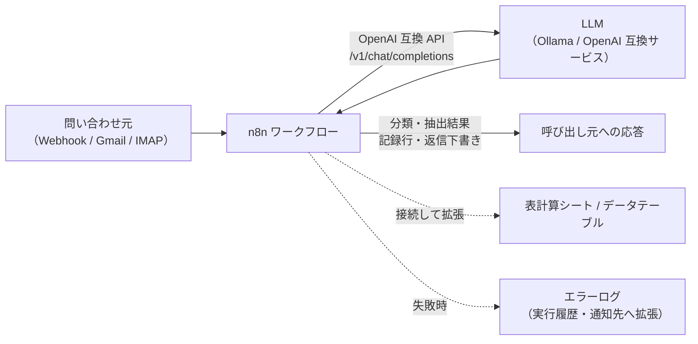

# 基本設計書

## 文書情報

| 項目 | 内容 |
|---|---|
| 文書名 | 基本設計書 |
| 文書ID | BD-001 |
| システム名 | n8n AI問い合わせメール仕分け |
| 版 | 1.1 |
| 作成日 | 2026-11-15 |
| 状態 | 承認済 |

## 改版履歴

| 版 | 日付 | 変更内容 |
|---|---|---|
| 0.1 | 2026-11-15 | 新規作成 |
| 1.0 | 2026-11-15 | テスト結果を反映し確定 |
| 1.1 | 2026-11-16 | 誤記を修正（要件の要約→用件の要約）。話し言葉を修正 |

## 1. 全体構成



- LLM は OpenAI 互換の Chat Completions API で呼び出す。Ollama も同じ形式の API を持つため、接続先の URL とモデル名を変えるだけで提供元を差し替えられる（ADR-0003）
- 標準のトリガーは Webhook とし、メールボックスがなくても動作を確認できるようにする（ADR-0001）

## 2. 機能一覧

| ID | 機能名 | 概要 | 関連要件 |
|---|---|---|---|
| FN-001 | 受信・入力検証 | Webhook で受け取り、件名・本文の有無と型を確認する。不備があれば LLM を呼ばずに入力エラーを返す | REQ-001、REQ-005、REQ-010 |
| FN-002 | LLM 分類・抽出 | 件名と本文から依頼文を組み立て、LLM に分類と抽出を1回で依頼する。通信失敗は再試行する | REQ-002、REQ-003、REQ-006、REQ-009 |
| FN-003 | 出力検証・再依頼 | LLM の出力を JSON として読み、スキーマ（必須項目・型・選択肢・文字数）で検証する。不正なら理由を添えて1回だけ再依頼する | REQ-007 |
| FN-004 | 分類別の振り分け | 分類ごとに担当窓口を決め、記録用の行データと返信の下書きを作る | REQ-004 |
| FN-005 | エラー処理・ログ | 入力エラー・LLM 通信失敗・出力不正を1つのエラー経路に集め、要確認の記録とエラーログを作って応答する | REQ-006、REQ-007、REQ-008 |

## 3. 分類カテゴリ定義

| 分類 | 判定の目安 | 担当窓口 | 返信下書きの方針 |
|---|---|---|---|
| 見積依頼 | 料金・費用・見積・発注前の相談 | 営業 | 受付のお礼と、見積に必要な情報（数量・希望納期など）の確認 |
| 不具合報告 | エラー・動かない・表示が崩れる等の障害の連絡 | サポート | 受付のお礼と、再現手順・発生日時・画面の状態の確認 |
| 請求関連 | 請求書・支払い・領収書・契約金額の確認 | 経理 | 受付のお礼と、確認して改めて連絡する旨 |
| その他 | 上記に当てはまらないもの（取材・採用・一般的な質問など） | 総合窓口 | 受付のお礼と、担当から連絡する旨 |
| 要確認 | LLM の失敗・出力不正で分類できなかったもの（システムが付ける） | 総合窓口 | 下書きは作らない。人が内容を読んで判断する |

## 4. 抽出項目の JSON スキーマ

LLM に返させる JSON の形を次のとおり定める。検証は FN-003 で行う（ADR-0002）。

```json
{
  "$schema": "https://json-schema.org/draft/2020-12/schema",
  "title": "InquiryTriageResult",
  "type": "object",
  "required": ["category", "company", "contact_name", "summary", "urgency"],
  "properties": {
    "category":     { "type": "string", "enum": ["見積依頼", "不具合報告", "請求関連", "その他"] },
    "company":      { "type": ["string", "null"], "maxLength": 100 },
    "contact_name": { "type": ["string", "null"], "maxLength": 50 },
    "summary":      { "type": "string", "minLength": 1, "maxLength": 200 },
    "urgency":      { "type": "string", "enum": ["高", "中", "低"] }
  }
}
```

| 項目 | 意味 | 取り出せない場合 |
|---|---|---|
| category | 分類（3章の4分類のいずれか） | 「その他」とする |
| company | 差出人の会社名 | null |
| contact_name | 差出人の担当者名 | null |
| summary | 用件の要約（200文字以内） | 必須（空は不正） |
| urgency | 緊急度。業務停止・期限の明示は「高」 | 「中」とする |

スキーマにない項目が返ってきた場合は、エラーにせず取り除く。

## 5. 応答の形

| 結果 | HTTP ステータス | status | 主な項目 |
|---|---|---|---|
| 成功 | 200 | ok | category、extracted、route、record、replyDraft、attempts |
| 要確認（LLM 失敗・出力不正） | 200 | needs_review | category（要確認）、record、error |
| 入力エラー | 400 | input_error | error |

要確認を 200 で返すのは、問い合わせ自体は受け付けて人の確認に回したことを呼び出し元に伝えるためである。
