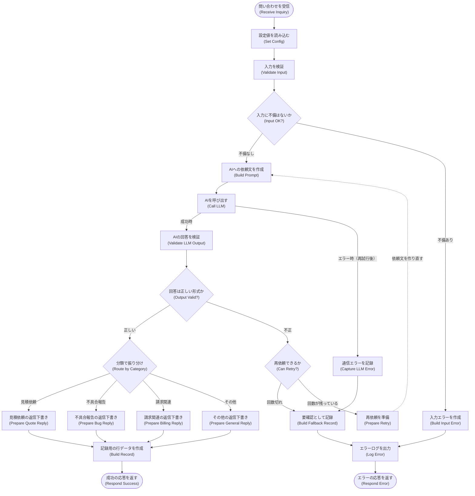

# フロー設計書

## 文書情報

| 項目 | 内容 |
|---|---|
| 文書名 | フロー設計書 |
| 文書ID | DD-FLW-001 |
| システム名 | n8n AI問い合わせメール仕分け |
| 版 | 1.3 |
| 作成日 | 2026-11-15 |
| 状態 | 承認済 |

## 改版履歴

| 版 | 日付 | 変更内容 |
|---|---|---|
| 1.0 | 2026-11-15 | 新規作成（ワークフロー JSON のノード構成から作成） |
| 1.1 | 2026-11-15 | 実行データの保存設定を追記 |
| 1.2 | 2026-11-15 | 全体図を「処理の内容（ノード名）」の日本語併記に変更 |
| 1.3 | 2026-11-15 | 再依頼の分岐ラベルを条件どおり「回数が残っている／回数切れ」に修正し、戻りの線を点線にして他の箱と重ならない配置に変更 |

## 1. 概要

| 項目 | 内容 |
|---|---|
| フロー名 | AI Inquiry Mail Triage (Portfolio) |
| 基盤 | n8n（動作確認: 2.3.5） |
| 対象ファイル | `workflow/ai-mail-triage.json`（`tools/build_workflow.py` で生成） |
| 実現する機能 | FN-001、FN-002、FN-003、FN-004、FN-005 |
| トリガー | Receive Inquiry（Webhook・POST） |
| ステップ数 | 21（付箋を除く） |
| 同時実行 | 実行ごとに独立しており、共有する状態はない |
| 実行データの保存 | ワークフローの設定 `saveDataSuccessExecution: none`（正常に終わった実行は保存しない）、`saveDataErrorExecution: all`（想定外の失敗は保存する） |

## 2. 全体図

図の各ボックスは「処理の内容（n8n のノード名）」の形で書いています。ノード名は n8n 上の実際の名前と同じで、式から参照されるため英語のままにしています。

## 3. ノード一覧

| No | ノード名 | 種類 | 機能 | 役割 | 入力 | 出力 |
|---|---|---|---|---|---|---|
| 1 | Receive Inquiry | Webhook | FN-001 | POST を受け付ける。応答は Respond 系ノードで返す | `from`・`subject`・`body` | リクエスト全体（`body` に入力） |
| 2 | Set Config | Edit Fields (Set) | FN-002 | 設定値を1か所にまとめる | なし | `llm_base_url`・`llm_model`・`llm_max_tokens`・`max_schema_retries`・`max_body_chars` |
| 3 | Validate Input | Code | FN-001 | 件名・本文の有無、型、長さを検証する | 設定値、Receive Inquiry の `body` | `inputValid`・`inputErrors`・`email`・`config`・`attempt`=1・`receivedAt` |
| 4 | Input OK? | If | FN-001 | 入力検証の結果で分岐する | `inputValid` | true / false |
| 5 | Build Prompt | Code | FN-002 | 依頼文（system・user）と要求本文を組み立てる。再依頼時は不正理由を追加する | `email`・`config`・`lastValidationError` | `requestBody` |
| 6 | Call LLM | HTTP Request | FN-002 | `{llm_base_url}/chat/completions` へ POST する | `requestBody` | Chat Completions の応答／エラー出力 |
| 7 | Validate LLM Output | Code | FN-003 | 応答の本文を JSON として読み、スキーマで検証する | LLM の応答、Build Prompt の文脈 | `outputValid`・`validationError`・`extracted` |
| 8 | Output Valid? | If | FN-003 | 検証結果で分岐する | `outputValid` | true / false |
| 9 | Can Retry? | If | FN-003 | 再依頼できる回数が残っているかを判定する | `attempt`・`max_schema_retries` | true / false |
| 10 | Prepare Retry | Code | FN-003 | 試行回数を1増やし、不正理由を引き継ぐ | 検証結果 | `attempt`+1・`lastValidationError` |
| 11 | Route by Category | Switch | FN-004 | 分類で4方向に分ける | `extracted.category` | 見積依頼／不具合報告／請求関連／その他 |
| 12〜15 | Prepare Quote Reply / Prepare Bug Reply / Prepare Billing Reply / Prepare General Reply | Edit Fields (Set) | FN-004 | 担当窓口と返信下書きを付ける | `extracted` | `route`・`replyDraft`（他の項目は引き継ぐ） |
| 16 | Build Record | Code | FN-004 | 記録用の行データと応答を作る | `extracted`・`route`・`replyDraft` | `httpStatus`=200・`response` |
| 17 | Respond Success | Respond to Webhook | FN-004 | 成功の応答を返す | `response`・`httpStatus` | HTTP 応答 |
| 18 | Build Input Error | Code | FN-005 | 入力エラーの応答を作る | `inputErrors` | `httpStatus`=400・`error`・`response` |
| 19 | Capture LLM Error | Code | FN-005 | LLM 通信失敗の内容を共通の形にする | エラー出力の `error` | `failure`（stage=llm_call） |
| 20 | Build Fallback Record | Code | FN-005 | 要確認の記録と応答を作る | `failure` または `validationError` | `httpStatus`=200・`error`・`response` |
| 21 | Log Error | Code | FN-005 | エラーログを1件作る（本文は含めない） | `error`・`logContext` | `logEntry` |
| 22 | Respond Error | Respond to Webhook | FN-005 | 入力エラー・要確認の応答を返す | `response`・`httpStatus` | HTTP 応答 |

ノード名は式から参照するため英語で統一する（例: `$('Build Prompt').last()`）。

## 4. 分岐条件

| 分岐ノード | 条件 | true / 出力先 | false / 出力先 |
|---|---|---|---|
| Input OK? | `inputValid` が true | Build Prompt | Build Input Error |
| Call LLM | 再試行後も失敗したか | 成功時: Validate LLM Output | エラー時: Capture LLM Error |
| Output Valid? | `outputValid` が true | Route by Category | Can Retry? |
| Can Retry? | `attempt <= max_schema_retries`（既定 1 のため、再依頼は1回） | Prepare Retry（→ Build Prompt） | Build Fallback Record |
| Route by Category | `extracted.category` が完全一致 | 4分類の各 Prepare ノード | （検証済みのため該当なしは発生しない） |

## 5. エラー処理表

| ID | 発生箇所 | 事象 | 再試行 | 扱い | 応答 | エラーログの stage |
|---|---|---|---|---|---|---|
| ERR-001 | Validate Input | 件名・本文がない、本文が長すぎる、本文が JSON オブジェクトでない | しない | LLM を呼ばずに終了 | 400 `input_error` | input |
| ERR-002 | Call LLM | 接続できない、タイムアウト、5xx などの HTTP エラー | 最大3回（初回を含む）、間隔2秒 | 要確認として記録 | 200 `needs_review` | llm_call |
| ERR-003 | Validate LLM Output | JSON として読めない、必須項目の欠落、選択肢外の値、文字数超過 | 理由を添えて1回だけ再依頼 | 要確認として記録 | 200 `needs_review` | llm_output |
| ERR-004 | Code ノード全般 | 想定外の例外（実装の不具合など） | しない | n8n の実行が失敗として記録される | n8n の既定のエラー応答 | （記録されない。導入・運用手順書のエラーワークフローで通知する） |

エラーログ（Log Error の出力 `logEntry`）の項目: `logged_at`・`received_at`・`stage`・`reason`・`attempts`・`execution_id`・`workflow`。問い合わせの本文と差出人は含めない。

## 6. 資格情報一覧

| 資格情報名（例） | 種類 | 使用ノード | 必要な場合 |
|---|---|---|---|
| LLM API | Header Auth | Call LLM | クラウドの LLM（OpenAI 互換 API）を使う場合。ローカルの Ollama では不要 |
| Webhook Auth | Header Auth | Receive Inquiry | Webhook を外部に公開する場合 |
| Gmail account | Gmail OAuth2 | Gmail Trigger（差し替え時） | トリガーを Gmail に差し替える場合 |
| IMAP account | IMAP | Email Trigger (IMAP)（差し替え時） | トリガーを IMAP に差し替える場合 |

値（API キー・パスワード）はワークフローの JSON とこのリポジトリに置かず、n8n の資格情報にだけ保存する。配布する JSON には資格情報を含めていない。
