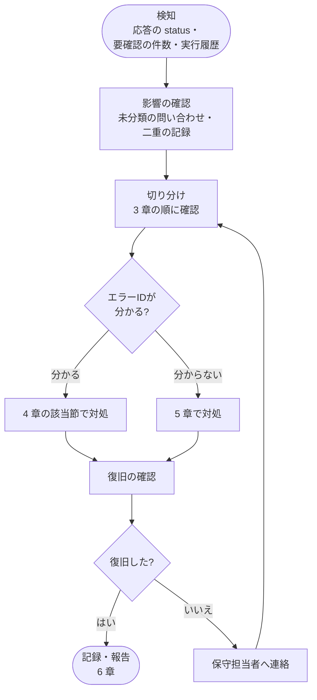

# 障害対応手順書

## 文書情報

| 項目 | 内容 |
|---|---|
| 文書名 | 障害対応手順書 |
| 文書ID | OP-INC-001 |
| システム名 | n8n AI問い合わせメール仕分け |
| 版 | 1.1 |
| 作成日 | 2026-11-16 |
| 状態 | 承認済 |

## 改版履歴

| 版 | 日付 | 変更内容 |
|---|---|---|
| 1.0 | 2026-11-16 | 新規作成 |
| 1.1 | 2026-11-16 | ERR-002・ERR-003 の再実行時に LLM を呼ぶ回数の上限を実装どおり（最大 6 回）に修正 |

## 1. 目的と対象

本書は、問い合わせメールの仕分けワークフローで障害が起きたときに、原因を切り分けて復旧し、記録を残すための手順を定める。

| 項目 | 内容 |
|---|---|
| 使う人 | 運用担当者（一次対応）、保守担当者（ワークフローの修正を伴う二次対応）。役割と連絡の順は 05_導入・運用手順.md の「12. 連絡体制」による |
| 使うとき | 応答が `input_error`（HTTP 400）・`needs_review` になったとき、要確認の件数が急に増えたとき、応答が返らない・n8n の既定のエラー応答が返ったとき、n8n の実行履歴に失敗した実行が残っていたとき |
| 対象 | `workflow/ai-mail-triage.json` のワークフロー（FN-001〜FN-005）と、その設定値（Set Config）・資格情報 |
| 対象外 | LLM の提供元・n8n 自体の不具合の修正、導入時に後ろへ接続する記録先（表計算シート等）のノード、Gmail・IMAP トリガーへの差し替え後の動作（未検証のため。05_導入・運用手順.md の 5 章） |

エラーID（ERR-001〜ERR-004）の定義は 03_フロー設計.md の「5. エラー処理表」にある。本書はその ID ごとに対応手順を書く。

## 2. 障害時の基本の流れ



- 影響の確認では、まず「人の確認に回っていない問い合わせがないか」を確かめる。要確認（`needs_review`）は取りこぼしではなく、人が対応すべき問い合わせとして記録されている状態である
- 本ワークフローは同じ問い合わせの重複を排除しない。再送すると記録先に行が増えるため、再送した問い合わせは記録先で整理する

## 3. 切り分けの順番

上から順に確かめ、異常が見つかった段で 4 章・5 章の該当箇所へ進む。

| 順 | 確かめること | 確認する場所・方法 | 正常なときの結果 | 異常なときの行き先 |
|---|---|---|---|---|
| 1 | n8n が動いていて、ワークフローが有効か | n8n の画面を開き、ワークフローが有効（Active）になっているか | 画面が開き、有効になっている | 5 章 5.1 |
| 2 | 応答の `status` と `error.stage` | 呼び出し元が受け取った応答、または記録先の行（`status` が「要確認」の行） | `status` が `ok` | 下表で ERR を決める |
| 3 | エラーログ | Log Error の後ろに接続した記録先・チャット通知の `logEntry`（`stage`・`reason`・`attempts`・`execution_id`） | 前回の確認から急に増えていない | `stage` で ERR を決める |
| 4 | n8n の実行履歴の失敗 | n8n の実行履歴で失敗した実行を絞り込む | 失敗した実行がない | ERR-004 |
| 5 | LLM に届くか | 下の確認コマンド | `choices` を含む JSON が返る | ERR-002 |
| 6 | 設定値が意図どおりか | Set Config ノードの `llm_base_url`・`llm_model`・`llm_max_tokens`・`max_schema_retries`・`max_body_chars`（既定値は 05_導入・運用手順.md の 3 章） | 既定値または導入時に決めた値 | 4 章の該当節 |
| 7 | 同じ入力で再現するか | 05_導入・運用手順.md の 4 章の `curl` で、問題の件名・本文を送る | 期待どおりの応答 | 再現した応答で 2 から確かめ直す |

応答・エラーログの `stage` とエラーIDの対応（`tools/build_workflow.py` の出力どおり）：

| `stage` | 応答 | エラーID |
|---|---|---|
| `input` | HTTP 400、`status` が `input_error` | ERR-001 |
| `llm_call` | HTTP 200、`status` が `needs_review` | ERR-002 |
| `llm_output` | HTTP 200、`status` が `needs_review` | ERR-003 |
| （なし） | n8n の既定のエラー応答。`status` を含む JSON が返らない | ERR-004 |

正常に終わった実行（成功・要確認・入力エラー）は、設定（`saveDataSuccessExecution: none`）により n8n の実行履歴に保存されない。Log Error の後ろに記録先を接続していない場合、ERR-001〜ERR-003 のエラーログは応答以外のどこにも残らない。日々の切り分けには、05_導入・運用手順.md の 6 章のとおり記録先を接続しておく必要がある。

LLM に届くかの確認（Ollama を同じ PC で動かしている場合。n8n を Docker で動かしているときは、n8n から見た接続先は `host.docker.internal` になる）：

```bash
curl -s http://localhost:11434/v1/chat/completions \
  -H 'Content-Type: application/json' \
  -d '{"model":"qwen2.5:7b","messages":[{"role":"user","content":"ping"}],"max_tokens":5}'
```

Call LLM と同じ `{llm_base_url}/chat/completions` に、同じモデル名で送る。クラウドの LLM では、n8n の資格情報に登録したものと同じ認証のヘッダーが必要になる（値は本書・コマンドの履歴に残さない）。

## 4. エラー別の対応手順

### 4.1 ERR-001 入力エラー

| 項目 | 内容 |
|---|---|
| 事象 | HTTP 400 で `{"status":"input_error","error":{"stage":"input","reason":"..."}}` が返る。`reason` は「リクエスト本文が JSON オブジェクトではありません」「subject（件名）がありません」「body（本文）がありません」「body（本文）が長すぎます（20000文字まで）」のいずれか（複数のときは ` / ` で区切る） |
| 影響 | その問い合わせは分類されず、記録用の行も作られない。LLM は呼ばない（費用はかからない）。データが壊れることはない |
| 想定原因 | 呼び出し元が件名・本文を送っていない、JSON でない本文を送っている、本文が `max_body_chars`（既定 20000 文字。前後の空白を除いた長さ）を超えている。トリガーを差し替えた場合は、詰め替えノードの項目名の誤り |
| 確認すること | 応答の `reason`。呼び出し元が送った JSON（`from`・`subject`・`body` の 3 項目か）。トリガーを差し替えた場合は、Validate Input が読む場所（05_導入・運用手順.md の 5 章） |
| 対処 | 呼び出し元を直して送り直す。本文が長すぎる正当な問い合わせは、人が元のメールを読んで対応する（上限を変える場合は Set Config の `max_body_chars` を変え、変更時の点検を行う） |
| 復旧の確認 | 送り直した要求が HTTP 200 で `status` が `ok` または `needs_review` になる |
| 再実行してよいか | よい。入力エラーでは記録用の行を作らず LLM も呼ばないため、送り直しても二重の記録や費用は生じない。ただし入力を直さずに送り直しても同じ 400 になる |
| 関連 | FN-001、FN-005、TC-005 |

### 4.2 ERR-002 LLM の呼び出しに失敗

| 項目 | 内容 |
|---|---|
| 事象 | HTTP 200 で `status` が `needs_review`、`error.stage` が `llm_call` になる。`error.reason` には n8n が受け取ったエラーの内容（例：`503`、`connect ECONNREFUSED`）が最大 300 文字で入る。記録用の行は分類が「要確認」、担当窓口が「総合窓口」 |
| 影響 | 問い合わせは分類されず、要確認として人の確認に回る（取りこぼしにはならない）。Call LLM は失敗のたびに 2 秒おいて最大 3 回（初回を含む）呼ぶため、応答が遅れる。応答待ちは 1 回 120 秒が上限で、すべてタイムアウトすると応答まで約 6 分かかる |
| 想定原因 | LLM が止まっている、`llm_base_url` の誤り（Docker の n8n から同じ PC の Ollama へは `host.docker.internal`）、`llm_model` に存在しないモデル名を指定している、クラウドの LLM の API キーの誤り・失効、LLM 側の過負荷 |
| 確認すること | `error.reason` の内容。3 章の順 5（LLM に届くか）。Set Config の `llm_base_url`・`llm_model`。クラウドの LLM では Call LLM に設定した資格情報 |
| 対処 | LLM を起動する。接続先・モデル名を直す。API キーの誤り・失効なら 05_導入・運用手順.md の 11 章の手順で資格情報を更新する |
| 復旧の確認 | 3 章の順 5 で `choices` を含む JSON が返り、05_導入・運用手順.md の 4 章の `curl` で `status` が `ok` になる |
| 再実行してよいか | よい。復旧後に同じ入力を Webhook に送り直せば再分類できる。ただし重複は排除しないため、記録先に元の要確認の行と新しい行の両方が残る。送り直した後に要確認の行を整理する。送り直すたびに LLM を呼ぶ。通信の失敗は 1 回の依頼につき最大 3 回試し、出力が不正なら 1 回だけ再依頼するため、送り直し 1 回あたり最大 6 回呼ぶことがある。クラウドの LLM では呼び出しの費用がかかる |
| 関連 | FN-002、FN-005、TC-006、TC-008 |

### 4.3 ERR-003 LLM の回答が不正

| 項目 | 内容 |
|---|---|
| 事象 | HTTP 200 で `status` が `needs_review`、`error.stage` が `llm_output`、`attempts` が 2 になる（`max_schema_retries` が既定の 1 のとき）。`error.reason` は「回答が空です」「JSON として読めません」「JSON オブジェクトではありません」「category がありません」「category が選択肢にありません」「summary は1〜200文字の文字列にしてください」など、検証で見つかった理由 |
| 影響 | 問い合わせは分類されず、要確認として人の確認に回る。LLM は初回と再依頼の 2 回呼ばれる。データが壊れることはない |
| 想定原因 | モデルが指定の JSON の形で答えない（モデルの変更・提供元の応答形式の違い）、回答が `llm_max_tokens`（既定 400）で途中で切れて JSON として閉じていない、問い合わせの内容が分類しにくい |
| 確認すること | `error.reason`。直前にモデル・提供元・`llm_max_tokens` を変えていないか。同じ入力を 3 章の順 7 で送り、再現するか |
| 対処 | 一時的なものなら、人が元のメールを読んで対応する。同じ理由の要確認が続く場合は、元のモデルに戻すか、保守担当者に依頼してモデル・依頼文（Build Prompt）・`llm_max_tokens` を見直し、テスト（`tests/run_live.py`）で確かめてから反映する |
| 復旧の確認 | 同じ入力で `status` が `ok` になる。要確認の件数が平常に戻る |
| 再実行してよいか | 送り直してよいが、同じモデル・同じ入力では同じ結果になりやすい。重複は排除しないため、送り直すと記録先に行が増える。送り直すたびに LLM を呼ぶ。出力の不正による再依頼は 1 回だけだが、各依頼で通信の失敗を最大 3 回試すため、送り直し 1 回あたり最大 6 回呼ぶことがある |
| 関連 | FN-003、FN-005、TC-007 |

### 4.4 ERR-004 想定外の例外

| 項目 | 内容 |
|---|---|
| 事象 | 呼び出し元に `status` を含む JSON が返らず、n8n の既定のエラー応答になる。n8n の実行履歴に失敗した実行が残る（`saveDataErrorExecution: all`） |
| 影響 | その問い合わせは分類も要確認の記録もされず、エラーログ（Log Error）も作られない。人が気づかないと取りこぼしになる。失敗した実行の保存データには問い合わせの本文が含まれる |
| 想定原因 | Code ノードの実装の不具合、n8n の版を上げたことによる動作の違い、トリガーの差し替え・記録先の接続などワークフローを手で変えたことによる不整合 |
| 確認すること | n8n の実行履歴で失敗した実行を開き、止まったノード名とエラーの内容を見る。直前に n8n の版・ワークフローを変えていないか |
| 対処 | 実行履歴の入力から元の問い合わせを確かめ、人が対応する。不具合は保守担当者が `tools/build_workflow.py` を直して JSON を作り直し、テスト（`tests/run_live.py`）で確かめてから取り込み直す。想定外の失敗に気づけるよう、n8n のワークフローの設定でエラーワークフローを指定して通知する（配布している JSON には設定していない） |
| 復旧の確認 | 同じ入力で `status` を含む応答が返る。調べ終わった失敗の実行データは、本文を含むため n8n の保存期間の設定に任せず削除する |
| 再実行してよいか | 不具合が直るまでは、送り直しても同じ箇所で失敗する。直した後は送り直してよい。止まった位置によっては LLM の呼び出しが済んでいる |
| 関連 | FN-001〜FN-005（Code ノード全般）。テストは未実施（04_テスト仕様書.md の 4 章） |

## 5. エラーIDの付かない障害

### 5.1 n8n の停止・ワークフローの無効化

n8n が止まっている、またはワークフローが有効になっていないと、Webhook への送信そのものが受け付けられず、ワークフローは動かない（エラーログも残らない）。n8n を起動し、ワークフローを有効にする。停止中に送られた問い合わせは、呼び出し元から送り直す。どれが届いていたか分からない場合、送り直すと記録先に重複の行ができるため、送り直した後に整理する。

### 5.2 LLM の応答の遅れと呼び出し元のタイムアウト

Call LLM は 1 回の応答待ちが最大 120 秒で、失敗すると 2 秒おいて最大 3 回呼ぶ。LLM が遅いと、1 回の依頼で最大約 6 分、出力が不正で再依頼した場合（`max_schema_retries` が既定の 1 のとき）は最大約 12 分かかる。呼び出し元の待ち時間がこれより短いと、呼び出し元はタイムアウトとして扱う一方で、ワークフローは処理を続けて結果を作る。呼び出し元が自動で送り直す設定だと、同じ問い合わせが二重に記録される。呼び出し元の待ち時間・再送の設定は導入時に決める項目とする。

### 5.3 LLM の提供元・モデルの変更

モデルを変えると、エラーにならないまま分類・緊急度の付け方が変わることがある（分類精度は評価していない。04_テスト仕様書.md の 4 章）。変えたときは `tests/run_live.py` で TC-001〜TC-008 を実行し、要確認の件数と分類の傾向を変更前と比べる。クラウドの LLM の応答形式は未確認のため、切り替えたときは ERR-003 の増加に注意する。

### 5.4 記録先・通知先のノードの失敗

導入時に Build Record・Log Error の後ろへ接続する記録先（表計算シート等）は配布している JSON に含まれず、そのノードのエラー時の扱いも設計していない。接続した時点で、記録に失敗したときに実行を止めるか続けるかを決め、本書に追記する。

### 5.5 トリガーの差し替え後の取りこぼし・二重読み込み

Gmail・IMAP のトリガーに差し替えた場合、同じメールを二度読む・読み落とすといった扱いはトリガーの設定（既読にする・対象のフォルダ）で変わる（05_導入・運用手順.md の 5 章）。差し替え後の動作は未検証のため、本番に入れる前にテスト用のメールボックスで確かめ、確かめた結果を本書に追記する。

## 6. 障害の記録と報告

障害ごとに次の項目を記録する。記録の保管場所・保管期間は運用で決める項目とする。問い合わせの本文・差出人は記録に書かない（エラーログと同じ方針）。

| 項目 | 書く内容 |
|---|---|
| 発生日時 | 最初に事象が起きた日時（エラーログの `received_at`・`logged_at` など）と、検知した日時 |
| 検知方法 | 呼び出し元の応答、要確認の件数、エラーログ、n8n の実行履歴、エラーワークフローの通知、利用者からの連絡 など |
| エラーID | ERR-001〜ERR-004。付かない場合は「なし（5 章の該当節）」 |
| 影響範囲 | 要確認になった件数、分類されなかった件数、二重に記録された件数、その間の `execution_id` |
| 原因 | 確定した原因。確定していなければ「調査中」とし、分かっている事実を書く |
| 対処 | 行った操作（送り直し・設定の変更・LLM の再起動・ワークフローの取り込み直し）と、その結果 |
| 再発防止 | 設定の変更、監視の追加、ワークフローの修正など。不要ならその理由 |

報告のひな形：

```markdown
## 障害報告

- 発生日時：YYYY-MM-DD hh:mm（検知：YYYY-MM-DD hh:mm）
- 検知方法：
- エラーID：
- 影響範囲：要確認 N 件、未分類 N 件、二重の記録 N 件
- 原因：
- 対処：
- 復旧の確認：（何を見て直ったと判断したか）
- 再発防止：
- 対応者（役割）：運用担当者／保守担当者
```

## 7. エラーID対応表

| エラーID | 意味 | 発生する機能 | 対応手順 | 関連テスト |
|---|---|---|---|---|
| ERR-001 | 入力エラー（HTTP 400、stage=input） | FN-001、FN-005 | [4.1](#41-err-001-入力エラー) | TC-005 |
| ERR-002 | LLM の呼び出しに失敗（needs_review、stage=llm_call） | FN-002、FN-005 | [4.2](#42-err-002-llm-の呼び出しに失敗) | TC-006、TC-008 |
| ERR-003 | LLM の回答が不正（needs_review、stage=llm_output） | FN-003、FN-005 | [4.3](#43-err-003-llm-の回答が不正) | TC-007 |
| ERR-004 | 想定外の例外（n8n の既定のエラー応答） | FN-001〜FN-005 | [4.4](#44-err-004-想定外の例外) | 未実施 |
